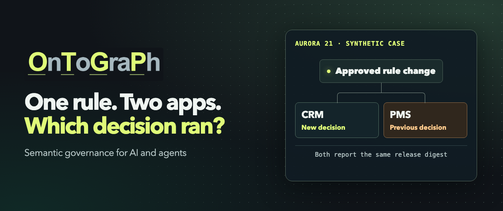
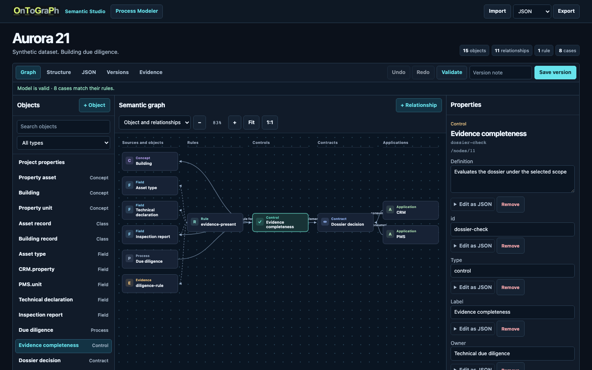

# OnToGraPh

[](https://openontograph.org/demo/)

[](https://github.com/sev7enITA/OntoGraph/actions/workflows/verify.yml)
[](#run-the-engine-and-studio)
[](https://openontograph.org/)

**OnToGraPh is a standalone semantic governance engine.** It connects dictionaries, taxonomies and ontology relationships to versioned rules, human approval and tests of downstream behavior. A data steward can trace a field back to its source, a reviewer can decide whether a rule should be released, and an operator can see which applications actually applied it.

[Project website](https://openontograph.org/) · [简体中文](https://openontograph.org/zh/) · [Wiki](https://github.com/sev7enITA/OntoGraph/wiki) · [Market and standards](docs/wiki/MARKET-AND-STANDARDS.md) · [Issues](https://github.com/sev7enITA/OntoGraph/issues)

## Start here

| Explore | What you can do |
| --- | --- |
| **[Run the interactive pilot](https://openontograph.org/pilot/)** · [中文](https://openontograph.org/pilot/zh/) | Follow a PolicyWatcher signal into a PALO case, change its evidence or authority, or try the standalone route. The public demo opens in a browser without an account. |
| **[Inspect the Aurora 21 evidence](https://openontograph.org/demo/)** · [中文](https://openontograph.org/demo/zh/) | Watch two simulated applications report the same release but produce different decisions. See how an unreachable application leaves withdrawal unproven. |
| **[Open the local Studio](#run-the-engine-and-studio)** | Edit a process visually, inspect individual properties and relationships, and review local versions with the bundled sample. |
| **[Watch the 90-second walkthrough](https://openontograph.org/film/)** · [中文](https://openontograph.org/film/zh/) | Follow the same pilot with narration, captions and a transcript. |

## From meaning to evidence

| Principle | What OnToGraPh connects |
| --- | --- |
| **O · Operational Ontology** | Stable dictionary and taxonomy identifiers, typed relationships, physical fields, processes, controls and consuming applications. |
| **T · Traceability to Every Field** | Source excerpts and applicability judgments, affected fields and rules, release manifests and consumer observations. |
| **G · Governance with Human Authority** | Frozen candidates, assigned reviewers, objections and quorum, separate publish authority and withdrawal. Release activation requires adequate evidence and approval. |
| **P · Proof of Behavior** | Per-application delivery and receipts, independent scoped probes, expiring observations and proof that a withdrawn rule stopped being used. |

The engine exports portable JSON release bundles and a JSON-LD projection using SKOS, OWL/RDFS and PROV-O terms. Release hashes and audit history can be checked against independently retained checkpoints. [Framework and roles](docs/FRAMEWORK.md) · [Formats, controls and CLI](docs/PROTOCOL.md)

## Run the engine and Studio

The reference engine runs with Python 3.10 or later and the standard SQLite module. It runs offline after cloning.

```sh
git clone https://github.com/sev7enITA/OntoGraph.git
cd OntoGraph
python3 -m ontograph demo
python3 -m ontograph studio
```

Open [the local Studio](http://127.0.0.1:8765/) to start in the Process Modeler. Choose **Semantic Studio** to inspect and edit nested properties, link a process to a control, and compare local drafts. [Studio guide](docs/wiki/STUDIO.md)

[](docs/wiki/STUDIO.md)

[Process Modeler preview](assets/studio/process-modeler.png) · [Evidence Workbench preview](assets/studio/evidence-workbench.png)

### Export the evidence locally

```sh
evidence_dir=$(mktemp -d)
python3 -m ontograph demo --report "$evidence_dir/aurora.json" --html "$evidence_dir/aurora.html"
python3 -m unittest discover -s tests -v
```

Open the exported `aurora.html` to inspect the observations. The verification workflow also publishes the HTML and JSON as its `ontograph-aurora-demo` artifact. [GitHub Actions runs](https://github.com/sev7enITA/OntoGraph/actions/workflows/verify.yml)

## What the pilot demonstrated

### Aurora 21 and standalone adoption

In **Aurora 21**, a simulated PMS reported the expected release digest while returning the previous rule's decision. During withdrawal, an unreachable PMS stayed unproven until a probe observed the withdrawn behavior had stopped. A newly approved candidate restored verified behavior on the declared cases. [Aurora 21 case notes](docs/wiki/AURORA-21.md) · [Evidence JSON](https://openontograph.org/demo/report.json)

A separate **calibration laboratory** used its own dictionary, taxonomy and rule. It returned allow, hold and out of scope with network access denied. Activation and withdrawal each required their own observation. [Run the standalone calibration](examples/hub_pilot/README.md#run-the-standalone-control)

### One hub, three frameworks

OnToGraPh grew out of **PolicyWatcher** and **PALO Framework**. It can serve as their shared ontology layer and can also be adopted on its own.

| Framework | Role in the hub |
| --- | --- |
| [PolicyWatcher](https://policywatcher.online/) | Provides bottom-up evidence of an observed policy change. A read-only adapter can resolve a released rule back to its source. |
| **OnToGraPh** | Binds the source change to an approved dictionary, rule and scope, and records what authorized consumers do. |
| [PALO Framework](https://github.com/sev7enITA/PALOframework) | Provides top-down human authority and lifecycle gates. Its Assessment Path can receive a case with its release evidence for review. |

A live PolicyWatcher record passed through a local OnToGraPh registry to a local instance of PALO’s Assessment Path. A signal with a mismatched change ID passed the format validator and was held by the scoped rule. The matched signal reopened **Measure** and **Prove** for human review. The case remained pending. [Recorded evidence](https://openontograph.org/pilot/evidence.json) · [Reproduction instructions](examples/hub_pilot/README.md)

## Where it fits

Use catalogs or ontology editors to maintain definitions, graph engines to query relationships, and Git and CI to manage code. OnToGraPh focuses on the point after a shared rule is approved. It helps teams establish what each application did, whether an exception is still open and whether a withdrawn rule stopped running.

The reference implementation uses one local registry per workspace. Aurora 21 uses simulators, and the hub pilot used scripted roles and a local PALO client. Observations cover declared cases and freshness windows. Qualification on real consumer systems, production tenancy and an independent observer deployment remain customer-pilot work. [Competitive landscape](https://openontograph.org/#market) · [Market proposal and adoption criteria](docs/MARKET.md) · [Cross-model reviews](docs/REVIEWS.md)

## Documentation and project files

| Start with | Read or use it for |
| --- | --- |
| [Documentation index](docs/wiki/README.md) and [GitHub Wiki](https://github.com/sev7enITA/OntoGraph/wiki) | Orientation, design principles, Visual Studio, the governance hub and Aurora 21 |
| [Framework](docs/FRAMEWORK.md) and [protocol](docs/PROTOCOL.md) | Governance roles, release operations, evidence contracts and interoperability |
| [Engine and local Studio](ontograph/) | Python modules and the visual workspace |
| [Examples](examples/) and [tests](tests/) | Reference fixtures, the optional hub adapters and regression checks |
| [Website](site/) and [brand assets](assets/brand/) | Source for the bilingual public site, pilot and project wordmark |

OnToGraPh was created by **Fabrizio Degni**. If you find an issue or want to propose an example, include the affected version, steps and the expected result. [Open an issue](https://github.com/sev7enITA/OntoGraph/issues/new) · [Citation metadata](CITATION.cff)
