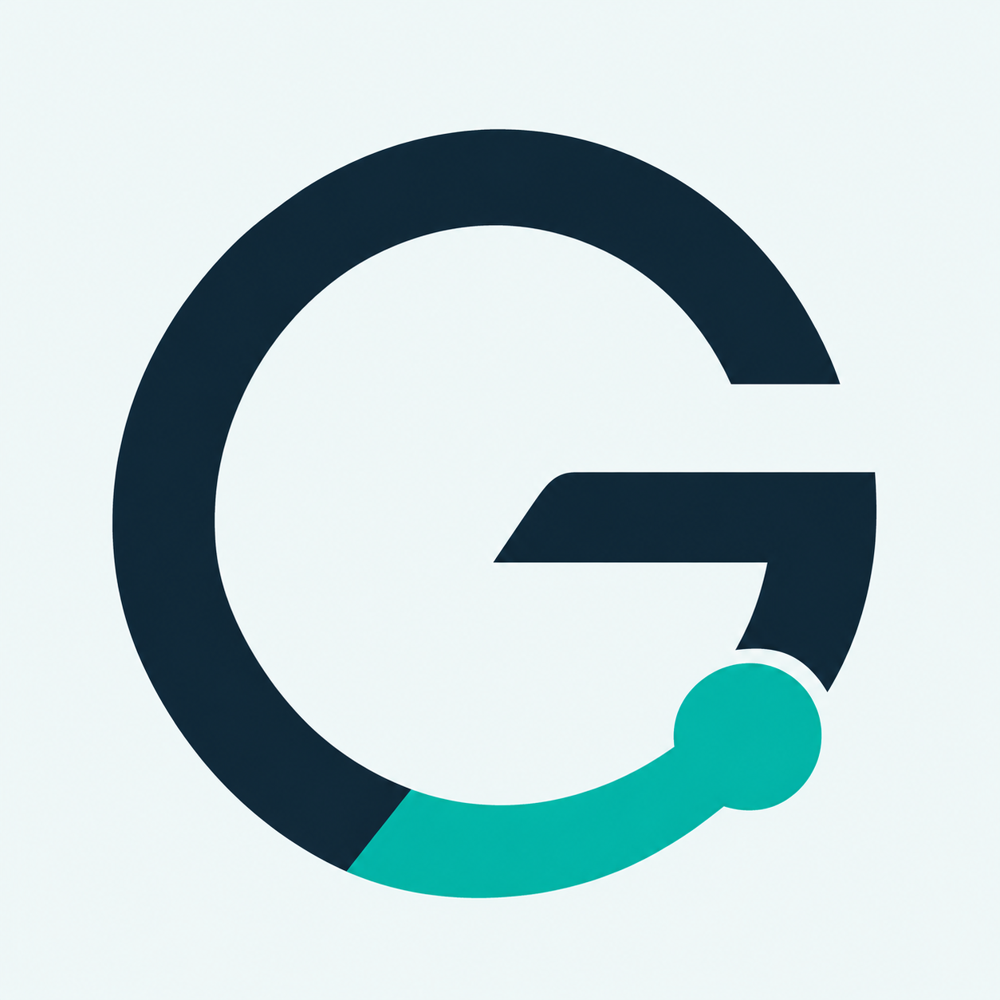

# Wiki OntoGraph

**Quando cambia una regola condivisa, quali applicazioni la stanno davvero applicando?**

OntoGraph collega il passaggio della fonte, il controllo interessato, l’approvazione e la versione distribuita agli esiti osservati in ogni applicazione. È pensato per responsabili Data Governance, AI Governance e Operational Risk che devono chiudere una modifica tra sistemi gestiti da persone diverse.

| Pagina | Cosa trovi |
| --- | --- |
| [Perché esiste OntoGraph](PERCHE-ONTOGRAPH.md) | Il problema, chi lo incontra e le domande a cui risponde il prodotto |
| [Oceano blu e standard](OCEANO-BLU.md) | Quando affiancarlo a cataloghi, knowledge graph o Git e CI e come misurare il vantaggio |
| [Studio visuale](STUDIO.md) | Modellatore originario, proiezione semantica, editor atomico ed export |
| [Aurora 21](AURORA-21.md) | Una regola cambia, il PMS dichiara il digest atteso e restituisce un risultato divergente |
| [Framework](../FRAMEWORK.md) | Ruoli, responsabilità, sei fasi PALO, controlli e limiti delle prove |
| [Protocollo e CLI](../PROTOCOL.md) | Formati, operazioni, scambio PolicyWatcher, osservazione e ritiro |
| [Proposta di mercato](../MARKET.md) | Acquirente, perimetro del primo pilota e domande per decidere se proseguire |

La **0.1** è una reference implementation offline con dati sintetici. Dimostra il ciclo di release e verifica su due applicazioni simulate. La validazione con applicazioni reali e la disponibilità a pagare sono obiettivi del primo pilota.

[Repository e avvio rapido](../../README.md)
